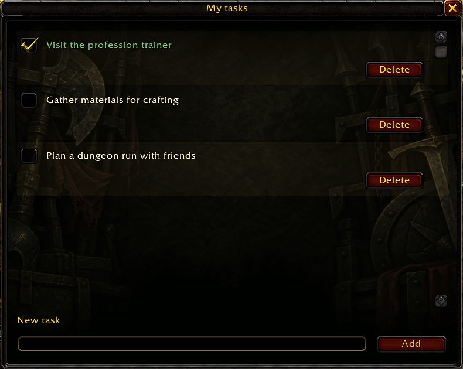
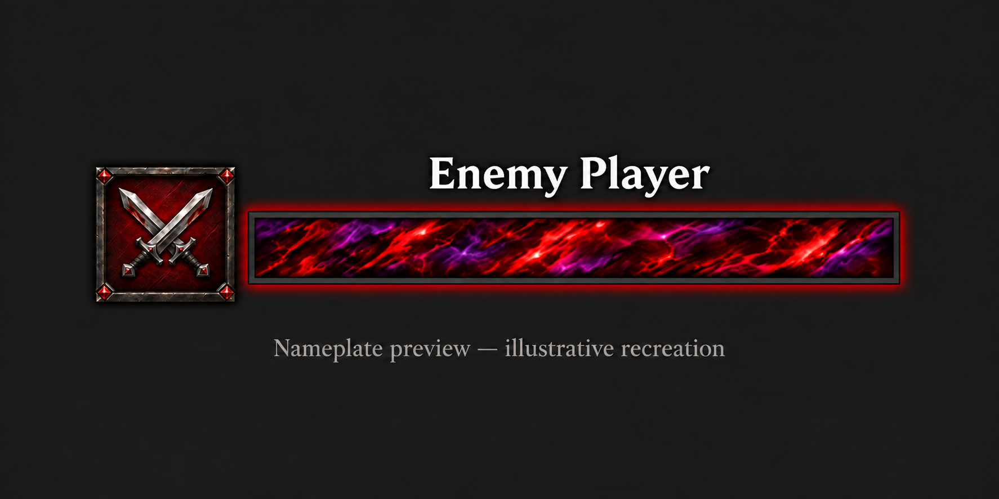
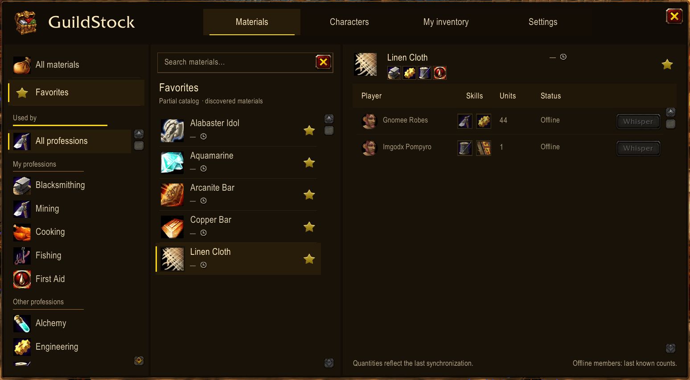
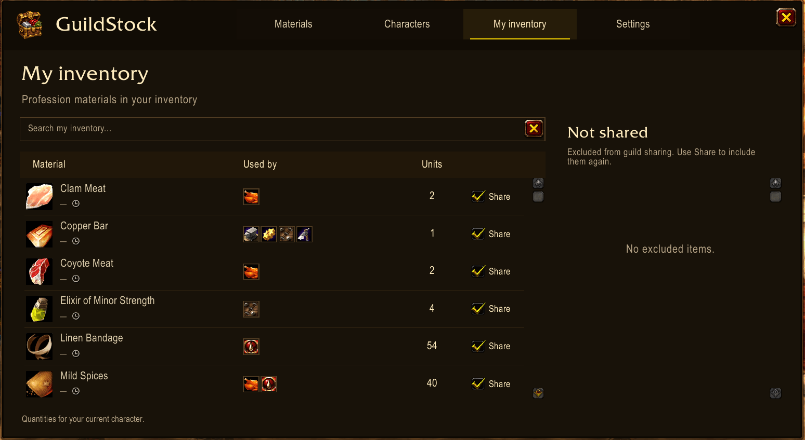

# WoW Forever Addons

**Organize your plans, remember your enemies, and find your guild's materials — without leaving Azeroth.**

Small, independent addons by [luisjedev](https://github.com/luisjedev) for **World of Warcraft: Forever**. Install only the ones you want.

[**GuildStock on CurseForge**](https://www.curseforge.com/wow/addons/guildstock) · [**Revenge: Enemy List on CurseForge**](https://www.curseforge.com/wow/addons/revenge-enemy-list) · [**TDL: ToDo List on CurseForge**](https://www.curseforge.com/wow/addons/tdl)

---

## The addons

<table>
  <tr>
    <td align="center" width="33%">
      
       
      <strong><a href="TDL">TDL</a></strong>
       
      Your in-game task list: add plans, edit them, and mark what you have completed.
       
      <code>/tdl</code> · <code>/todo</code> · minimap button
       
      <a href="https://www.curseforge.com/wow/addons/tdl"><strong>Download on CurseForge</strong></a>
    </td>
    <td align="center" width="33%">
      
       
      <strong><a href="Revenge">Revenge</a></strong>
       
      Keep a list of enemy players and recognize their nameplates when the game allows identification.
       
      <code>/rvg</code> · minimap button
       
      <a href="https://www.curseforge.com/wow/addons/revenge-enemy-list"><strong>Download on CurseForge</strong></a>
    </td>
    <td align="center" width="33%">
      
       
      <strong><a href="GuildStock">GuildStock</a></strong>
       
      Find profession materials and see which guildmates have them, with automatically shared inventories.
       
      <code>/guildstock</code> · minimap button
       
      <a href="https://www.curseforge.com/wow/addons/guildstock"><strong>Download on CurseForge</strong></a>
    </td>
  </tr>
</table>

Hover over a minimap icon for its controls: left-click to open or close, and drag with the left mouse button to move it around the minimap. Position is saved per character, subject to the beta persistence limitation below.

---

### TDL · Remember your plans

  

Unfinished quests, materials to gather, or plans for your next session.

- Create, edit, complete, and delete tasks in a movable, classic gold-framed window.
- All tasks share one vertically scrolling list.
- Click a truncated task to expand or collapse it, or double-click any task to edit its text directly.
- Edits save automatically when you leave the field, close the window, reload the UI, or log out.
- The window opens on login or UI reload when you have unfinished tasks.
- Follows your game's language.

**Open it:** minimap button, `/tdl`, or `/todo` · **Get it:** [TDL: ToDo List on CurseForge](https://www.curseforge.com/wow/addons/tdl)

---

### Revenge · Some faces are worth remembering

  

<em>Nameplate preview — illustrative recreation, not an in-game screenshot.</em>

- Add your current target with one click, or enter their first name and surname.
- Browse your saved list and delete entries you no longer need.
- Spot saved players on their nameplates, with a marker and a distinctive style when the game allows identification.
- Follows your game's language, with English as the fallback.

**Open it:** minimap button or `/rvg` · **Get it:** [Revenge: Enemy List on CurseForge](https://www.curseforge.com/wow/addons/revenge-enemy-list)

---

### GuildStock · Who has what your professions need

  

  

- Browse profession materials, keep favorites, and see which guildmates hold each material and how many they have.
- Inventories are shared automatically with your guild: each character sends only its own, and offline members keep their last dated counts.
- Exclude individual materials, or stop sharing altogether in Settings, without losing your local inventory.
- Ships with a partial catalog of 589 materials and their observed profession associations, plus local auction-price estimates where available.
- Cross-shard delivery still needs two-client validation.

**Open it:** minimap button, `/guildstock`, or the chest shortcut in the native Professions window · **Get it:** [GuildStock on CurseForge](https://www.curseforge.com/wow/addons/guildstock) · Full guide: [GuildStock README](GuildStock/README.md)

---

## Installation

### From CurseForge (easiest)

Install any of the three addons from its CurseForge page with the CurseForge app:

- [GuildStock](https://www.curseforge.com/wow/addons/guildstock)
- [Revenge: Enemy List](https://www.curseforge.com/wow/addons/revenge-enemy-list)
- [TDL: ToDo List](https://www.curseforge.com/wow/addons/tdl)

You can also browse them on [my CurseForge page (Artidev)](https://www.curseforge.com/members/artidev/projects).

### From this repository

1. Download the repository using **Code → Download ZIP** and extract it.
2. Copy the `TDL` folder, the `Revenge` folder, the `GuildStock` folder, or any combination into `World of Warcraft/_classic_beta_/Interface/AddOns/`.
3. Check that the paths are `AddOns/TDL/TDL.toc`, `AddOns/Revenge/Revenge.toc`, and `AddOns/GuildStock/GuildStock.toc`.
4. Restart the game and enable the addons on the character selection screen.

Do not copy the entire repository folder into `AddOns`. You do not need development tools to play.

---

## Current status

The addons are in development for **WoW Forever beta**, with interface `16001`. Compatibility with Retail, Classic Era, or other versions is not assumed.

Forever replaces traditional realm selection with Normal (PvE), PvP and Roleplaying rulesets, with Hardcore planned after launch. Characters use a full first name and surname, unique within a region. For development, layers/shards are temporary world placement, not character or guild identities. See the shared [rulesets, layers and addon communication reference](docs/BLIZZARD_API.md#forever-rulesets-layers-and-addon-communications) for sources and testing requirements.

Some beta builds have shown problems restoring saved data after reloading the interface or closing the game. This can affect tasks and the enemy list. Game restrictions may also prevent Revenge from identifying certain players. See the [compatibility log](docs/BLIZZARD_API.md) for the builds reviewed and the tests still pending.

## Ideas and issues

You can [open an issue](https://github.com/luisjedev/wow-forever-addons/issues/new) to suggest improvements or report a problem. Include the addon, game version, and steps to reproduce it. Remove personal data from any screenshots or error reports before sharing them.

To contribute code, see the [development guide](docs/DEVELOPMENT.md).

## License

This project is released under the [MIT License](LICENSE). Some bundled data in GuildStock comes from third-party sources; see [GuildStock's third-party notices](GuildStock/THIRD_PARTY_NOTICES.md) for their terms.

---

<em>An independent project with no affiliation with Blizzard Entertainment. World of Warcraft belongs to Blizzard Entertainment.</em>

